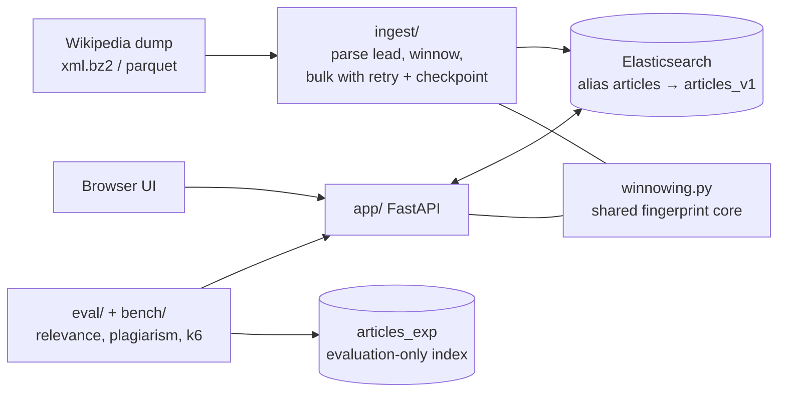

# verity

[](https://github.com/wanderingtilldeath/verity/actions/workflows/ci.yml)


**Full-text search and plagiarism detection over Wikipedia, built on Elasticsearch 8, FastAPI and Python 3.12.**

Search a few hundred thousand Wikipedia articles with relevance-ranked, highlighted results, autocomplete and
"related articles", then paste in any text and find which articles it copies from, down to the matching
passages. The same fingerprinting core also detects near-duplicate documents and template drift in text you
supply yourself.

## The problem

- **Search:** keyword search that is only "grep with a database" ranks poorly. This project shows how far
  well-chosen analyzers, field boosts and BM25 tuning go, and *measures* it instead of asserting it.
- **Plagiarism and duplicate detection:** comparing a document against every other document is quadratic.
  Verity fingerprints each document with **winnowing**, indexes the fingerprints, and uses Elasticsearch to
  fetch a small candidate set that is then re-ranked exactly. Any copied run of 8 or more words is
  guaranteed to be found.
- **Trustworthy numbers:** this is a rebuild of a 2020 Solr + Python project that had no public code and
  unverifiable claims. Every figure in this repo must come from a file under `eval/results/` or
  `bench/results/`, regenerated by `make report` into [docs/results.md](docs/results.md).

> **Status:** code complete; unit and integration tests pass against Elasticsearch 8.19. **No relevance,
> plagiarism or latency measurements are recorded yet**, so none are quoted here. The spec is in
> [.scratch/verity/spec.md](.scratch/verity/spec.md).

## Features

- Ranked search with title boost, phrase and exact-title boosts, HTML-safe highlights, deep paging via PIT
- Autocomplete (`search_as_you_type`) and "did you mean" (phrase suggester)
- Related articles (`more_like_this`)
- Plagiarism check with containment and Jaccard scores and passage-level alignment
- Dedupe and template-drift endpoints that need no index
- Resilient bulk ingest: process-pool parsing, 429 retry, dead letter file, checkpoint and resume
- Offline relevance and plagiarism evaluation, k6 benchmarks, Prometheus metrics, structured JSON logs

## Tech stack

| Layer | Choice |
|---|---|
| Search engine | Elasticsearch 8.19 (single node, Docker Compose) |
| API | FastAPI + `AsyncElasticsearch`, Pydantic v2 / pydantic-settings |
| Language and tooling | Python 3.12, [uv](https://docs.astral.sh/uv/), ruff, pytest, Hypothesis |
| Ingest | `mwparserfromhell` (wikitext), `pyarrow` (parquet), process and thread pools |
| Evaluation | NumPy, matplotlib, NLTK WordNet (synonym-swap transformations), bootstrap CIs |
| Load testing and ops | k6, Prometheus client, GitHub Actions CI (lint, unit, ES integration) |

## Architecture



| Package | Role |
|---|---|
| `ingest/` | Dump → clean Lead (≤ 5,000 chars) → fingerprints → size-bounded bulk requests. Owns the alias and `reindex_and_swap`. |
| `app/` | HTTP API. `search.py` builds queries; `plagiarism.py` does `terms_set` candidate fetch, Python re-rank and passage alignment; `reuse.py` does dedupe and drift in memory; `winnowing.py` is the fingerprint core. |
| `eval/`, `bench/` | Relevance eval (redirect titles as known-item queries), plagiarism eval (seeded transformations), k6 benchmarks. |
| `es/` | Index mapping and settings; design notes in [es/README.md](es/README.md). |

Design decisions are recorded as ADRs in [docs/adr/](docs/adr/), and
[docs/INDEX.md](docs/INDEX.md) maps every feature to its code and tests.

```
 GET  /search         multi_match + phrase + exact boost, highlights, PIT paging
 GET  /suggest        search_as_you_type + phrase suggester
 GET  /related/{id}   more_like_this
 POST /plagiarism/check   terms_set → re-rank → passages
 POST /reuse/dedupe, /reuse/drift   in-memory winnowing, no ES
 GET  /healthz /metrics
```

## Quickstart

```bash
uv sync                                # Python 3.12 pinned in .python-version
make up                                # Elasticsearch 8.19 in Docker (give Docker Desktop >= 6 GB)
make setup                             # also fetches the WordNet data used by the eval
# Stage A: Simple English Wikipedia (verify name, date and licence at download time)
mkdir -p ~/data/wikisearch && cd ~/data/wikisearch
curl -LO https://dumps.wikimedia.org/simplewiki/latest/simplewiki-latest-pages-articles.xml.bz2
cd - && make ingest-a
make serve                             # http://127.0.0.1:8000  (UI at /, OpenAPI at /docs)
make test                              # unit tests + integration tests (needs ES)
```

`make test-unit` runs without Elasticsearch. Tests marked `es` are skipped, not failed, when no cluster answers.

## API

| Route | What it does |
|---|---|
| `GET /search?q=&size=&from=&highlight=&explain=&cursor=` | `multi_match` over `title^4` + `text`, a title phrase boost and an exact-title boost. Unified-highlighter snippets (HTML-escaped, `<mark>` only). `from+size` up to 10,000; beyond that `cursor=start` opens a PIT and each response carries `next` (`search_after`). `explain=true` returns scoring explanations when `ALLOW_EXPLAIN=true`. |
| `GET /suggest?q=` | Autocomplete from `search_as_you_type` (`bool_prefix`) and a phrase-suggester "did you mean". |
| `GET /related/{id}` | `more_like_this` on title and text, source excluded; 404 if the id is unknown. |
| `POST /plagiarism/check` | `{text, threshold?, max_results?}`. Input capped at 50,000 characters (413) and needs at least 8 words (422). Returns matches with containment, Jaccard and matching passages (character offsets on both sides). |
| `POST /reuse/dedupe` | `{documents: [{id, text}], threshold?}`. Clusters near-duplicate documents (Jaccard of fingerprint sets, default 0.6) and suggests the longest as canonical. No ES needed. Capped by `REUSE_MAX_DOCS` (413). |
| `POST /reuse/drift` | `{approved: [{id, text}], text, threshold?}`. Splits `text` into paragraphs and labels each `unchanged`, `drifted` (with matching passages) or `new` against the best approved clause. No ES needed. |
| `GET /healthz` | Pings ES, checks the alias, and fails if the index's winnowing parameters differ from the code's. |
| `GET /metrics` | Prometheus: per-route counters and latency histograms, ES `took`, ES errors, candidate counts. |

Every ES call has a client request timeout and a server-side `timeout`. Errors are one shape,
`{code, message, request_id}`; a stopped ES gives 503, an ES timeout 504.

## Index design

See [es/README.md](es/README.md) and [docs/adr/](docs/adr/). In short: alias `articles` over `articles_v1`;
1 shard / 0 replicas (single node, reproducible BM25 statistics); custom analyzer (standard tokenizer,
possessive stemmer, lowercase, stop, asciifolding keeping the original, light English stemmer);
`title.exact` (keyword + normalizer) and `title.suggest` (`search_as_you_type`); `text` with offsets for the
unified highlighter; `dynamic: strict`. During bulk loads `refresh_interval` is `-1`, restored in a `finally`.

## Plagiarism detection

Winnowing (Schleimer, Wilkerson, Aiken, SIGMOD 2003): normalise → word 5-grams → 64-bit hash → keep the
minimum hash in every window of 4 (rightmost on ties) → fingerprint set with word positions. **Any shared run
of at least k + w − 1 = 8 words yields a common fingerprint**; this is property-tested with Hypothesis
(`tests/test_winnowing.py`), along with determinism across processes and hash seeds.

Query path: fingerprints go into a `keyword` array (norms off, excluded from `_source`). The check runs a
`terms_set` query to fetch candidates (at least 2 shared hashes and at least 5% of the input's hashes), then
re-ranks in Python by containment and Jaccard and aligns shared fingerprints into passages.

Evaluation (`make eval-plagiarism`): 500 seeded source Articles, one query per transformation (exact copy,
10% word deletion/insertion, WordNet synonym swaps, sentence reordering, two-source mixes) plus two negative
sets built from held-out pages that were never indexed. Reported per transformation: recall@1/5/10,
precision and recall at the chosen threshold, average precision and a PR curve. **Synonym swaps will score
lowest**: winnowing hashes exact words, so replacing about 30% of them destroys most 5-grams. That is a
property of the method, not a bug, and the table is meant to show it.

## Reuse: dedupe and template drift

The same winnowing core also works on documents you supply, with no index: `/reuse/dedupe` finds
near-duplicate articles in a knowledge base, and `/reuse/drift` shows which sections of a contract or
proposal differ from approved clauses. Both match copied and lightly edited text, not paraphrase, and
run in memory (fine for a few thousand documents). No accuracy figures exist yet; they must come from `docs/results.md`.

## Relevance

`make eval-relevance`: queries are Wikipedia **redirect titles** (alias → target Article gives ground truth
without human judgement). Configs: (1) standard analyzer, single field; (2) built-in English analyzer;
(3) the production query (custom analyzer, title boost, phrase and exact boosts); (4) config 3 with BM25
`k1`/`b` tuned on a **dev** split. All numbers are on the held-out **test** split, with 95% bootstrap CIs and
paired bootstrap comparisons. Redirects measure **known-item search only**.

## Latency

`make bench` (k6): `/search` at concurrency 1/10/50, cold vs warm, at 250k and 1.2M documents on the same
index (ADR 0002); `/suggest`, `/related`; `/plagiarism/check` latency against input length. Raw k6 output is
saved; p50/p95/p99 tables in `docs/results.md` are generated from the saved summaries.

## Elasticsearch vs Solr (notes from using Solr at CDAC)

These are working notes, not benchmarks; check them against the versions you run.

| Topic | Solr | Elasticsearch |
|---|---|---|
| Schema | `managed-schema` / schema API, field types defined once and reused | Mappings per index, `dynamic: strict` available; multi-fields (`title.exact`) replace copyField |
| Analysis | Analyzer chains on field types | Analyzers/normalizers in index settings, tested with the `_analyze` API |
| Queries | Request params (`q`, `fq`, `defType=edismax`, `qf`, `bq`) | JSON query DSL (`bool`, `multi_match`, `terms_set`); easier to build programmatically, more verbose to hand-write |
| Ranking | BM25 default since 8.0 | BM25 default since 5.0; per-field `similarity` makes k1/b experiments cheap |
| Highlighting, MLT | Highlighter and MoreLikeThis handler/component | Highlighters per request, `more_like_this` query |
| Suggest | `SuggestComponent` (separate dictionaries/lookups) | `search_as_you_type`, completion and phrase suggesters |
| Visibility | Soft/hard commit | `refresh` (1 s default) plus translog; refresh disabled during bulk loads here |
| Scaling | SolrCloud + ZooKeeper, collections/shards/replicas | Cluster state in the cluster itself, indices/shards/replicas |
| Reindex | Collection aliases | Index aliases; here via scan + bulk because fingerprints are derived data |

## Limits

- Known-item evaluation only; informational relevance is not judged (an optional ~30-query hand-judged set is described in the spec).
- Single node on a laptop, with k6 and Elasticsearch sharing the machine: latency numbers are not production figures.
- "Cold cache" is approximated by a container restart plus `_cache/clear`; Docker Desktop on macOS does not let us drop the page cache.
- Lead sections only (ADR 0001); Stage B extraction differs slightly from Stage A.
- The plagiarism set is synthetic. Real plagiarism is messier in some ways and easier in others, and WordNet swaps ignore inflection.
- Wikipedia contains near-duplicate leads; the evaluation reports them separately rather than as false positives.
- No authentication, no multi-node, no embeddings or hybrid search.

## Data and attribution

Article text comes from Wikipedia contributors and is licensed
[CC BY-SA 4.0](https://creativecommons.org/licenses/by-sa/4.0/) (and GFDL, for Wikimedia dumps). Text is
cleaned and truncated to the lead section; results link back to the source article. Dumps are not
redistributed. Verify the exact dump names, dates and licence wording at download time; the ingest CLI
records file name, size and sha256 in `eval/results/corpus_manifest.json`.

## Reproducing

| Step | Command |
|---|---|
| Stage A ingest | `make ingest-a` |
| Stage B ingest, pausing at 250k | `make ingest-b B_SOURCE=xml B_PATH=…`, benchmark, then `make ingest-b-resume B_SOURCE=xml B_PATH=…` |
| Redirects for relevance | `python -m ingest redirects --titles ~/data/wikisearch/titles_A.tsv --xml <dump> --out ~/data/wikisearch/redirects_A.jsonl` |
| Experiment index | `python -m eval.relevance.build_exp_index --grid full` |
| Relevance eval | `make eval-relevance` |
| Plagiarism eval | `make eval-plagiarism`, ablation: `python -m eval.plagiarism.ablation --cases <cases.jsonl>` |
| Benchmarks | `python -m bench.build_queries …`, then `LABEL=250k make bench` |
| Tables | `make report` |
